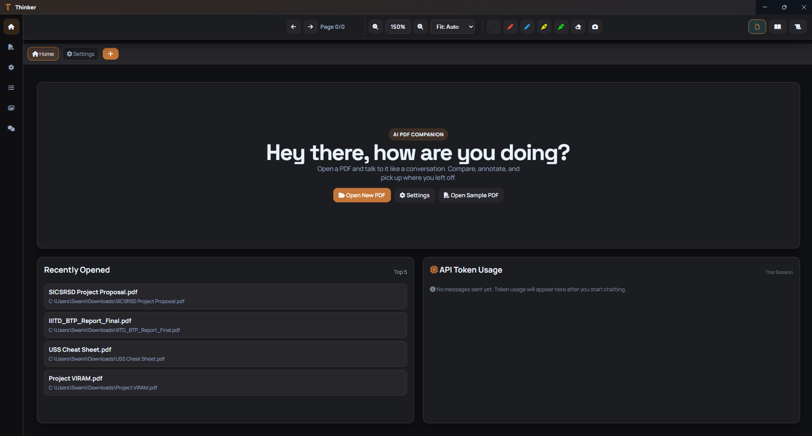
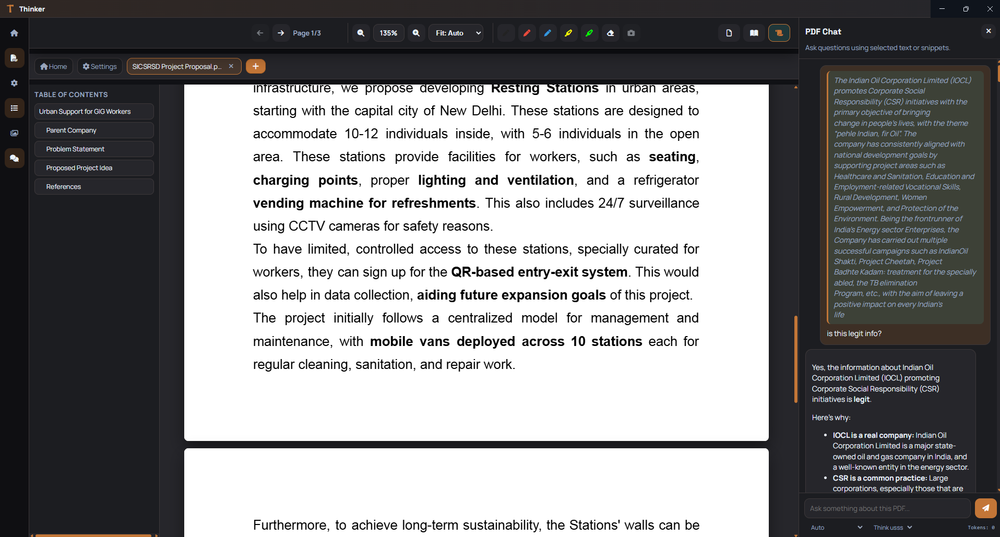
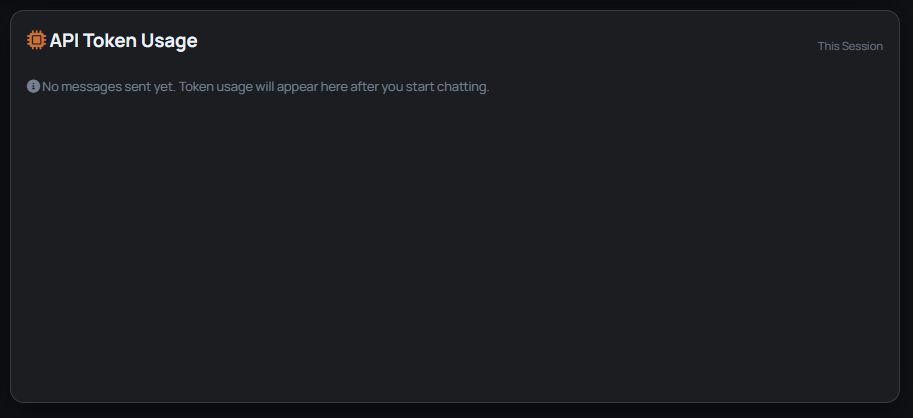

# Thinker — AI-Powered PDF Reader

Thinker is a premium, AI-powered PDF reading and annotation desktop app built with Electron. It combines a sophisticated multi-tab reading experience with deep Gemini AI integration, letting you have real conversations with your documents — complete with source citations, AI insights, and clickable page references.

> **📸 Screenshot Placeholder — Home Screen**


---

## 🌟 Features Overview

### 📖 Advanced PDF Reading

- **Multi-Tab Support** — Open multiple PDFs simultaneously and switch between them in an instant with the tab bar.
- **Three View Modes** — Single Page, Two-Page Spread, and Continuous Scroll for every reading style.
- **Smart Navigation** — Interactive Table of Contents (Outline) and Thumbnail sidebar for jumping directly to any page.
- **Precision Zoom** — Granular custom zoom levels with `Fit: Auto`, `Fit: Width`, and `Fit: Actual` presets.
- **High-Accuracy Text Selection** — Re-engineered text layer with mathematical baseline alignment for pixel-perfect, theme-matched selection highlights that scale correctly with every zoom level.

> **📸 Screenshot Placeholder — PDF Reader View**

---

### 🤖 AI-Powered Chat (RAG)

Thinker uses a **Retrieval-Augmented Generation (RAG)** pipeline — your PDF is embedded locally, and only the most relevant chunks are sent to the AI per query, keeping responses accurate and token-efficient.

#### Dual Chat Modes

| Mode | Behaviour |
|---|---|
| **Auto** | AI can combine document context with its own external knowledge for richer, analytical answers. |
| **Document Only** | AI is strictly restricted to the content found in the PDF — no hallucinations. |

#### Smart Source Attribution

Every AI response is **visually classified** so you always know exactly where information came from:

- 🧠 **AI Insights header** — appears at the top of a response when the AI has used external knowledge or reasoning.
- 📄 **Document Only header** — confirms the response is sourced entirely from the PDF.
- **`Page X` chips** — inline, clickable teal chips that instantly jump the PDF viewer to the exact referenced page.
- **✨ AI Knowledge chips** — inline purple gradient chips marking sentences generated from the AI's own external knowledge, not the document.

> **📸 Screenshot Placeholder — Chat with Citation Tags**


#### Other Chat Features

- **Context-Aware RAG** — Top 3 most relevant document chunks are retrieved per query and injected as context.
- **Conversation History** — Last 6 turns of history are summarized and sent with each request to maintain coherent multi-turn dialogues.
- **Typing Indicator** — An animated three-dot loader shows while the AI is generating a response.
- **Persistent Chat History** — All conversations are stored per-PDF in `.jsonl` format and reloaded when you reopen the document.
- **Image Attachment** — Attach a screenshot or image to your message for visual context.
- **Selected Text Context** — Highlight any text in the PDF to automatically include it as a quoted reference in your next message.

---

### 📊 API Token Usage Tracking

Thinker has built-in token monitoring so you never accidentally exhaust your API quota.

- **Per-Message Token Footer** — Each AI response bubble shows `Tokens: X (Y in, Z out)` at the bottom.
- **Live Chat Bar Tracker** — A subtle monospace display next to the mode selector shows the token cost of the last request.
- **Home Screen Dashboard** — The **API Token Usage** panel on the Home screen accumulates session-wide stats:
  - Total Prompt Tokens sent
  - Total Response Tokens received
  - Grand Total and Request count
  - Last request cost
  - Visual Prompt vs. Response split bar chart

> **📸 Screenshot Placeholder — Home Screen Token Usage Panel**


---

### ✍️ Professional Annotations

- **Multi-Tool Support** — Separate Pen and Highlighter tools, each with their own configurable color and stroke width.
- **Smart Eraser** — Precise path-based erasing to clean up individual strokes.
- **Auto-Save** — All annotations are automatically persisted locally and reloaded every time you open the document.

---

### 🎨 Premium UI & Customization

- **Dark / Light Modes** — Seamlessly switch themes; all citation chips, panels, and dropdowns adapt using CSS `color-mix`.
- **Custom Accent Colors** — Choose any accent color in Settings; the entire palette — chips, buttons, borders, and bars — recalculates dynamically.
- **Resizable Panels** — Drag the inner edge of the Chat Panel or the Left Sidebar to freely resize them. The PDF viewer re-renders automatically when you release.
- **Chat Close Button** — A subtle `✕` button in the chat header lets you instantly collapse the panel to full-screen reading mode.
- **VS Code-Style Chat Controls** — Mode selector and Profile selector sit below the input bar, blending into the panel without visual clutter.
- **Toast Notifications** — Non-intrusive, themed status toasts for file events and errors.

> **📸 Screenshot Placeholder — Settings Screen**


---

## 🚀 Getting Started

### Prerequisites

- **Node.js** v16 or higher
- **Python 3.9+** (for the local RAG embedding service)
- A **Gemini API Key** from [Google AI Studio](https://aistudio.google.com/)

### Installation

1. **Clone the repository**:
   ```bash
   git clone <repository-url>
   cd SmartPDFReader
   ```

2. **Install Node dependencies**:
   ```bash
   npm install
   ```

3. **Install Python dependencies** (for the RAG backend):
   ```bash
   cd agent-handler
   pip install -r requirements.txt
   cd ..
   ```

4. **Configure environment**:
   ```bash
   cp .env.example .env
   ```
   Open `.env` and add your Gemini API Key:
   ```env
   GEMINI_API_KEY=your_actual_key_here
   ```

### Running the App

You need **two terminals** running simultaneously:

**Terminal 1 — RAG Backend:**
```bash
cd agent-handler
fastapi dev
```

**Terminal 2 — Electron App:**
```bash
npm start
```

Then go to **Settings → AI Profiles**, add your Gemini API key, select a model (e.g. `gemini-2.5-flash-lite`), and you're ready to go.

---

## 🛠️ Technical Stack

| Layer | Technology |
|---|---|
| Desktop Shell | Electron.js |
| PDF Rendering | PDF.js |
| RAG Backend | FastAPI + Python |
| AI Model | Google Gemini API |
| Styling | Vanilla CSS with HSL/OKLCH dynamic variables |
| Icons | FontAwesome 6 |
| Markdown Parsing | marked.js |

---

## 💾 Data Management

- **Settings & Profiles** — Stored in local JSON files (theme, API keys, active model).
- **Chat History** — Persisted per-PDF in `.jsonl` format; reloaded on next open.
- **Annotations** — Stored locally, mapped to specific PDF file paths.
- **Recent Files** — Last accessed PDFs tracked per device.

---

## 📈 Token Optimization

Thinker is designed to be frugal with your API quota on free-tier keys:

- Only the **top 3 RAG chunks** (max 400 chars each) are sent per request.
- **Conversation history** is capped at the last 6 turns (120 chars each).
- **System prompts** are condensed to a single tight instruction sentence.
- **Output is capped** at 512 tokens per response via `generationConfig.maxOutputTokens`.

This keeps typical requests to **~800–1,000 tokens** per message.

---

Built with ❤️ for a better reading experience.
